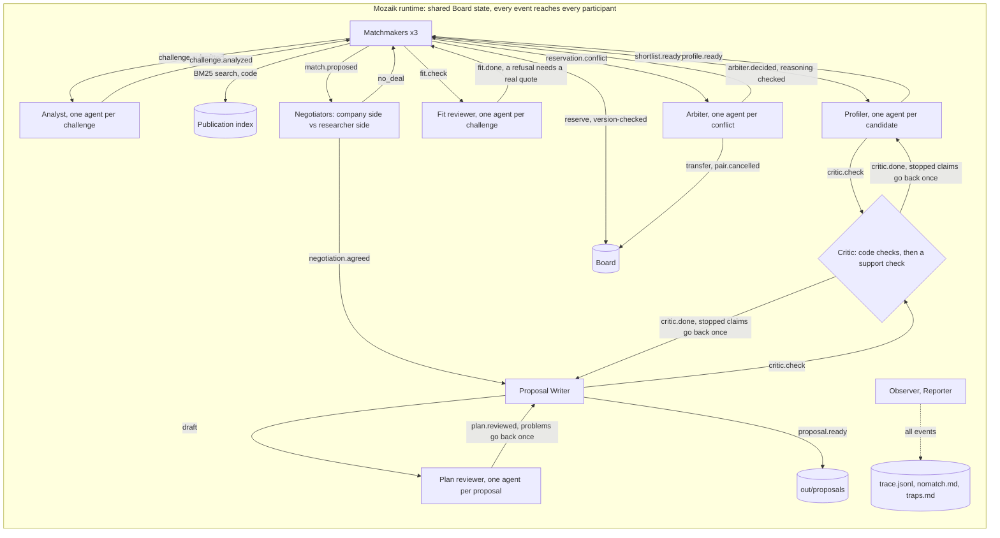

<div align="center">

<picture>
  <source media="(prefers-color-scheme: dark)" srcset="media/readme-hero-dark.svg">
  
</picture>

<br>

[](https://github.com/jigjoy-ai/mozaik)
[](tsconfig.json)
[](#run-it-no-api-key-needed)
[](#run-it-no-api-key-needed)
[](test/)
[](https://github.com/jigjoy-ai/einstein-matchmaker-data)

**[Run it](#run-it-no-api-key-needed)** · **[Tour](#a-two-minute-tour-of-the-board)** · **[How it works](#how-it-works)** · **[Mozaik](#mozaik-features-used)** · **[Concurrency](#concurrency)** · **[Results](#does-it-work)**

</div>

<br>

**Agents that find researcher-company pairs in the EINSTEIN network, pre-negotiate the terms that usually stall collaborations, and say no when there is no good match.**

Built on [Mozaik](https://github.com/jigjoy-ai/mozaik) for the NTP Novi Sad × JigJoy Hackathon, EINSTEIN track.

**Try the board online: [prenup-board.onrender.com](https://prenup-board.onrender.com)**. It replays the recorded run, with no key and no model calls. It's on a free plan, so the first visit after a quiet spell takes about a minute, and every visitor shares one board.


## In short

- **It agrees the terms before anyone meets.** For each pair, a company-side and a researcher-side agent with opposing positions built from the data negotiate the organizers' "Agreed up front" section: format, IP, publication review, exclusivity. A person can edit those terms and approve or reject each proposal on the board.
- **It checks who can really do the work.** Search finds shared words; a fit review reads each candidate's whole record, notes included, and turned down 40 of the 87 candidates it read. A plan review then reads each proposal as a sceptical company lead and professor would, and sent 28 problems back to the writers.
- **It says no.** On 15 sampled challenges it wrote 11 proposals and 4 reasoned no-matches (all four are business tasks, not research problems: registering as an auditor, entering the EU market, a loan application, hiring).
- **The concurrency is real and measured.** Matchmakers race for researchers on a shared board with version-checked writes, and an Arbiter settles conflicts: 0 double-booked researchers on all 489 challenges, against 104 with last-writer-wins. The demo run has two real conflicts, and the Arbiter is never told who wrote first. Parallel agents ran 3.9x faster than one call at a time (measured on the earlier 4-challenge demo).
- **Every fact has a source, and a Critic checks it.** 20 of 20 planted false claims stopped. In the demo run 64 of 68 proposal sentences made it in, 18 of them after a rewrite. What no record supports is listed on the page as "To confirm at the meeting".
- **No key needed.** Every model answer is recorded, so `npm run demo -- --replay` reruns everything offline in about 25 s.

## Run it (no API key needed)

```sh
npm run setup && npm run demo -- --replay
```

You need git and Node.js 22 or newer. Tested on Linux (Node 22.18) and Windows 10 and 11 (Node 24), not yet on macOS. The replay writes [`out/proposals/`](out/proposals/) (one page per pair), [`out/nomatch.md`](out/nomatch.md), [`out/traps.md`](out/traps.md) and [`out/trace.jsonl`](out/trace.jsonl) (every event, one JSON line each). `npm test` runs the unit tests; on a slow machine the two that load the whole dataset can pass vitest's 5 s limit, so use `npx vitest run --testTimeout=60000`.

<details>
<summary><b>No bash?</b> Set up in PowerShell, cmd or any other shell</summary>

<br>

`npm run setup` needs bash. In any other shell:

```sh
npm ci
git clone https://github.com/jigjoy-ai/einstein-matchmaker-data.git data/einstein
git -C data/einstein checkout 4fb99b3
npm run demo -- --replay
```

</details>

> [!TIP]
> **Watch it run:** `npm run board`, open http://localhost:4173 and press **Run the demo set**. The agents run again on the recorded answers, each arriving after its recorded latency (8x faster, about 30 s). **Plant false claims** runs the Critic test. Ids open the cited dataset record; the moon button switches to a dark theme.

**More challenges:** `npm run batch -- --replay` replays the 15-challenge run into [`out/batch/`](out/batch/). Any other challenge needs your own Anthropic key in `.env` the first time (`npm run demo -- C041-CH2`): answers not yet recorded are fetched and recorded.

### A two-minute tour of the board

1. **The fit review.** On the SecureEdge Labs card (`C032-CH1`), R1008 is a strong fit and R1015 only partial: the sensor has 512 MB of RAM, and only R1008's records show work on edge hardware. Search alone can't see that.
2. **The conflict.** ArmaturaSec (`C001-CH1`) reserved R1008 first. SecureEdge Labs wanted the same researcher; its write failed the version check, so nobody overwrote anybody.
3. **The decision.** The Arbiter keeps R1008 with ArmaturaSec. R1015 is a partial-fit alternative for both, so this is a close call, and ArmaturaSec loses more search relevance by taking it (11% against 5%). "Reasoning checked: 2 of 3 citations backed" is the check that ran before the decision was published, and it lists the one it couldn't back.
4. **The re-match.** Matchmaker-2 re-matches SecureEdge Labs to R1015 by itself, reacting to the Arbiter's event. The same happens on the membrane fouling pair: R0269 stays with `C144-CH2`, whose work matches the interest in R0269's notes, and `C088-CH2` re-matches to R0745.
5. **The negotiation.** The `C001-CH1 × R1008` tab reads as a conversation. It's an industrial PhD. The company asks to own the results; the researcher wants university ownership with an option to assign and a 30-day publication review; the company accepts the option and asks for 60 days to screen data held under NDA, and the researcher accepts in round 4.
6. **Your decision.** Under the agreed terms, **Edit** changes the format, IP, publication review, exclusivity or money, and each edit goes through the Critic's term checks (try contract research for R1015: refused, it isn't in their `open_to`). Then **Approve** or **Reject**. Nothing is sent to anyone: sending isn't built.
7. **The no and the trap.** KartografTech (`C043-CH3`) wants to raise a seed round: not a research problem. On Zlatna Njiva (`C061-CH1`), R0128 is skipped because the notes describe another person. **Plant false claims**: 20 false claims we planted, all stopped; the first credits R0881 with a paper by R0128, who has the same name.

<p align="center">
  
  <br>
  <sub><b>Step 6:</b> an edit the Critic allows, one it refuses, and the approval button counting the changes.</sub>
</p>

<p align="center">
  
  <br>
  <sub><b>Step 7:</b> Plant false claims, in the dark theme.</sub>
</p>

## How it works

1. **Reads the challenge.** An Analyst turns each company challenge into research questions and search terms, or says it isn't a research problem.
2. **Searches in code.** BM25 over 10,779 publications (Cyrillic transliterated) shortlists 5 researchers per challenge; a Profiler reads only those and writes a card where every fact cites a dataset id. Code flags retired, consulting-only and stale profiles, notes about someone else, and same-name pairs.
3. **Reviews fit.** A fit reviewer reads every pairable candidate's whole record, notes included, and says who could do the work the challenge needs, not just who shares its topic, and which format suits it. Turning someone down takes a quote that code finds in the record; without one it counts as "partly". This is about one piece of work, never a person's worth.
4. **Competes for limited capacity.** Three matchmakers reserve researchers on a shared board with a version check. When two want the same person, an Arbiter decides with cited reasons, and the loser re-matches by itself.
5. **Negotiates the terms.** Each side's position is built in code from the data (the company's R&D capacity, plans and past collaborations; the researcher's `open_to`, projects, publication record and checked card). Every move cites the exact words behind each citation, and a check removes citations those words don't back. The researcher side can only offer what that researcher is open to. Either side can accept early or walk away.
6. **Reviews the plan.** The research questions and plan state no facts, so the Critic never sees them. A fresh plan reviewer does: a measure the data can't produce, work a side has no record of, access nobody offered. What it finds goes back to the writer once. It also lists agreed contributions no record supports, printed as "To confirm at the meeting".
7. **Checks every claim.** The Critic checks each sentence before it's used: the cited record exists, the quote is in it word for word, the record belongs to that person (by id, never by name), no ranking or personal attributes, every number is in a cited field. Then a cheap model checks the sentence says no more than its sources. A stopped claim goes back to its author once, with the reason; if it's still stopped, the check's own shorter sentence gets one last try before the claim is dropped.
8. **Writes it up, or says no.** One page per pair in the organizers' format, a no-match report and a trap report.



Nobody calls anybody: each participant reacts to events.

## Mozaik features used

| Feature | Where | What for |
|---|---|---|
| `defineRuntime` with a `RuntimeState` subclass | [`src/runtime.ts`](src/runtime.ts) | The Board: version-checked reservations, negotiation moves, cancelled pairs |
| `createAgent`, a fresh agent per task | [`analyst.ts`](src/agents/analyst.ts), [`profiler.ts`](src/agents/profiler.ts), [`fit-review.ts`](src/agents/fit-review.ts), [`arbiter.ts`](src/agents/arbiter.ts), [`negotiator.ts`](src/agents/negotiator.ts), [`writer.ts`](src/agents/writer.ts) (and its plan reviewer) | Memory never crosses challenges, researchers or sides, and every answer maps back to its task |
| Agent memory across turns | [`negotiator.ts`](src/agents/negotiator.ts), [`writer.ts`](src/agents/writer.ts) | Each negotiator keeps its side of the conversation; the writer fixes its own draft |
| `createHuman` for participants that are code | [`matchmaker.ts`](src/agents/matchmaker.ts), [`critic.ts`](src/agents/critic.ts), [`observer.ts`](src/agents/observer.ts), [`reporter.ts`](src/agents/reporter.ts) | Matchmakers, the Critic's code checks, the trace and the reports |
| Situation handlers (`SituationSpecification`) | [`src/runtime.ts`](src/runtime.ts) (`on`, `own`, `anyEvent`) | Every participant reacts to events instead of being called |
| Custom `SemanticEvent`s | every agent (`prenup.*`, listed in [CONCURRENCY.md](CONCURRENCY.md)) | Conflict, decision, re-match, moves, Critic verdicts |
| Fire-and-forget `runLoop` with `structuredOutput` from zod | [`src/schema/model-schema.ts`](src/schema/model-schema.ts) and every agent | Typed answers; all loops run at the same time |
| A custom `InferenceRunner` | [`src/llm/runner.ts`](src/llm/runner.ts), [`src/llm/fixtures.ts`](src/llm/fixtures.ts) (`rehydrate`) | Record and replay, at most 8 calls in flight, retries, cost per run, paced replay for the board |

## Concurrency

<picture>
  <source media="(prefers-color-scheme: dark)" srcset="media/readme-race-dark.svg">
  
</picture>

Every challenge, candidate, conflict and pair gets its own agent, and every model loop is fire-and-forget, so analysts, profilers, arbiters and negotiations think at the same time. The matchmakers share one board and never overwrite each other: a reservation only succeeds against the version the matchmaker read. More in [CONCURRENCY.md](CONCURRENCY.md).

The Arbiter is never told which side holds the researcher, so writing first can't sway it: its brief is the same either way, and in a run where timing let `C088-CH2` write first for R0269, it still chose `C144-CH2`. In the demo's R1008 conflict, R1008 is a strong fit and R1015 a partial one on both challenges, so the fit review doesn't separate them. The Arbiter then follows its close-call rule, with percentages computed by code from BM25 relevance (R1015 scores 11% lower than R1008 on `C001-CH1` and 5% lower on `C032-CH1`), and its reason ends, verbatim: *"so [R1008] goes to [C001-CH1]."*

<details>
<summary><b>The race in <code>out/trace.jsonl</code></b>: the events behind the animation</summary>

```json
{"type":"prenup.match.proposed","producer":"matchmaker-1","payload":{"pairId":"C001-CH1__R1008","reservationVersion":1, "...": "..."}}
{"type":"prenup.reservation.conflict","producer":"matchmaker-2","payload":{"researcherId":"R1008","challengeId":"C032-CH1","holder":"C001-CH1","seenVersion":0,"version":1}}
{"type":"prenup.arbiter.decided","producer":"arbiter:R1008","payload":{"researcherId":"R1008","winner":"C001-CH1","loser":"C032-CH1","version":1,"check":{"cited":3,"backed":2,"notBacked":["R1015"],"numbersNotInBrief":[]}, "...": "..."}}
{"type":"prenup.rematch","producer":"matchmaker-2","payload":{"challengeId":"C032-CH1","from":"R1008", "...": "..."}}
{"type":"prenup.match.proposed","producer":"matchmaker-2","payload":{"pairId":"C032-CH1__R1015","reservationVersion":1, "...": "..."}}
```

</details>

## Does it work?

<picture>
  <source media="(prefers-color-scheme: dark)" srcset="media/readme-stats-dark.svg">
  
</picture>

All numbers are from recorded runs; raw data is in [`out/eval/`](out/eval/) and [`out/batch/`](out/batch/), and `npm run eval` reruns the offline ones.

| Measurement | Result |
|---|---|
| **The demo set** (8 challenges, 3 matchmakers) | 7 proposals, 1 no-match (not a research problem), 2 conflicts settled by the Arbiter. Fit review: 33 candidates read, 11 turned down. Plan review: 13 problems sent back, 5 contributions marked to confirm. Claims: profile cards 105 (51 stopped on the first pass, 86 pass after one rewrite), proposals 68 sentences (22 stopped, 64 pass after the rewrite and last try), terms 70 (all pass). Recorded live at most 4 calls at once: 246 model calls, about 260 s, $2.29 at list price, about $0.33 per proposal (a later replay makes fewer, because the local cache skips Analyst and profile answers) |
| **15 more challenges** (seeded sample, seed 42; 13 sectors, 7 Serbian-language companies; one, `C144-CH2`, is now also in the demo set; `npm run batch`) | **11 proposals, 4 reasoned no-matches** (all four not research problems). From lime dosing for Vojvodina soils to podcast ad targeting and compostable lidding film; formats chosen per company, e.g. consulting for a 4-person IT firm. Fit review: 54 candidates read, 29 turned down; the podcast challenge went to a marketing professor before the fit review and now goes to a Serbian-language NLP researcher. No conflicts and no failed negotiations. The Critic checked 375 claims and stopped 105 on the first pass; 6 proposal sentences dropped. 353 model calls, $3.38 at list price, about $0.31 per proposal ([`summary.json`](out/batch/summary.json)). A first attempt at 8 calls in flight was stopped by the gateway's rate limit; this run used 4 |
| **Parallel vs one call at a time**, measured on the earlier 4-challenge build, before the fit and plan reviews: the demo set run twice live with fresh answers, same code, up to 8 model calls at once vs `--in-flight=1` | **173.9 s vs 680.6 s (3.9x faster)**, 94 vs 95 model calls; $1.11 vs $1.36. The parallel run hit the gateway's rate limit 6 times and retried. Fresh answers, so the two runs took slightly different paths ([`concurrency.json`](out/eval/concurrency.json), with both logs and traces) |
| **Planted false claims**: 20 claims of 7 kinds built from real records (fake ids, altered quotes, same-name swaps, engagement not in `open_to`, invented money, retired or departed researchers, sentences that say more than their quote) | **20/20 stopped**: code checks 16, the support check the 4 overstatements; 16/20 without it ([`critic.json`](out/eval/critic.json)) |
| **Version check + Arbiter vs last-writer-wins**: the real matchmaker code on all 489 challenges, code stand-ins for the model agents, seed 42 | **0 double-booked researchers vs 104** (promised to 264 challenges at once); the price is 438 conflicts settled by re-matching ([`arbiter-versioned.json`](out/eval/arbiter-versioned.json)) |
| **How often the Critic stops a true sentence**, read on the earlier 4-challenge build: every first-pass stop in that demo run, read against the dataset | 10 of 23 were true (5 of them quotes not word for word), 7 really said more than their sources, 6 were judgement calls; 3 true sentences were dropped after the rewrite. Was 14 of 32 before the support check was eased ([`critic-false-stops.json`](out/eval/critic-false-stops.json)) |
| **Negotiation citations** that survived the run's checks | 9, all resolve to real records; read against their statements, 5 back them and 4 in part; 16 were removed during the run ([`citations.json`](out/eval/citations.json)) |

> [!NOTE]
> The false-stop and citation readings above were done by Claude, the coding agent that helped build this, not by an independent person.


The demo set replayed at its recorded latency: 246 model calls in 252 s, up to 35 open at once (a call counts from its request to its answer, waiting for one of the 8 slots included; the latencies were recorded at 4 calls at once).

## Where the Critic stepped in

The code checks stop a profile claim whose quote isn't word for word, or whose number isn't in any cited field. The support check stops a sentence that says more than its sources: here the writer said two security engineers would work part-time, and the record only says the company has four security engineers. It went back to the writer with a suggested sentence.

<details>
<summary><b>The verdicts</b>, as they appear in the trace</summary>

```json
{"type":"prenup.critic.verdict","producer":"critic","payload":{"pairId":"profile:C022-CH3__R0240","attempt":1,"claimId":"profile:C022-CH3__R0240/1","subject":"R0240","verdict":"block","check":"quote","reason":"quote not found in SYN-PUB-03044.abstract"}}
{"type":"prenup.critic.verdict","producer":"critic","payload":{"pairId":"profile:C032-CH1__R1008","attempt":1,"claimId":"profile:C032-CH1__R1008/3","subject":"R1008","verdict":"block","check":"numbers","reason":"512 is not in any cited field"}}
{"type":"prenup.critic.verdict","producer":"critic","payload":{"pairId":"C032-CH1__R1015","attempt":1,"claimId":"C032-CH1__R1015/companyBrings/2","subject":"C032","verdict":"rewrite","check":"support","reason":"Claim states two security engineers part-time; field states four security engineers total with no part-time distinction", "...": "..."}}
```

</details>

Each proposal lists, under "How we got here", every problem the plan review sent back and every claim the Critic stopped, and what happened to it.

## Proposals

| Pair | The problem | Format |
|---|---|---|
| [C001-CH1 × R1008](out/proposals/C001-CH1__R1008.md) | Finding unusual network behaviour with no attack examples, for ArmaturaSec, after the Arbiter kept R1008 on this challenge | Industrial PhD |
| [C032-CH1 × R1015](out/proposals/C032-CH1__R1015.md) | The same kind of problem on a 512 MB edge sensor, for SecureEdge Labs, re-matched after that decision | Joint project |
| [C061-CH1 × R0231](out/proposals/C061-CH1__R0231.md) | Why cold-pressed pumpkin seed oil goes rancid early | Contract research |
| [C022-CH3 × R0662](out/proposals/C022-CH3__R0662.md) | Irrigation scheduling built into farm software before the 2026 season | Joint project |
| [C047-CH1 × R0689](out/proposals/C047-CH1__R0689.md) | Ranking distribution transformers by failure risk | Joint project |
| [C144-CH2 × R0269](out/proposals/C144-CH2__R0269.md) | Membrane fouling in protease production, after the Arbiter kept R0269 on this challenge | Contract research |
| [C088-CH2 × R0745](out/proposals/C088-CH2__R0745.md) | Membrane fouling in dairy plants, re-matched after that decision | Joint project |

Also: the [no-match report](out/nomatch.md), the [trap report](out/traps.md), and the [15 more challenges](out/batch/).

## How it plugs into the EINSTEIN network and EINSTEIN Stars

**EINSTEIN network.** Prenup becomes the intake step for companies at NTP Novi Sad and the partner clusters: a company submits a challenge, and the tech-transfer team gets a negotiated draft with a named university group, or a reasoned "no good match, here's why". Staff edit and approve before anyone is contacted. Each partner university plugs in its own researcher records; the Critic and negotiation rules stay the same. The numbers to track are time to a first negotiated draft and how often both sides accept the meeting.

**EINSTEIN Stars.** Our understanding, not yet confirmed with the organizers: EINSTEIN STARS is the project's competitive programme for PhD students and young researchers with strong industrial potential. For early-career researchers who list industrial-PhD work in what they're open to, Prenup proposes concrete industrial PhD topics with a company already interested and the terms pre-agreed; for selected Stars, it finds company partners. It never ranks candidates: every proposal answers one company's challenge.

## Responsible use of data

- Proposes collaborations; never scores or ranks people. Fit is per challenge.
- Only offers what each researcher listed in `open_to`, and respects retired and consulting-only status; a reviewer's edits are held to the same rules.
- Researcher records carry no personal attributes (age, gender, origin), and the Critic stops any sentence that mentions them. Company challenge text can mention an employee's situation: the no-match report doesn't print such a text, though agents still read it.
- A person edits, approves or rejects each proposal on the board; nothing is sent to anyone.
- Uses only the provided synthetic dataset. In a real deployment: data minimization, opt-out for researchers, records refreshed from the university's own systems.

## Limits and honest notes

- The human gate is one person on one machine: decisions and edits are saved in `out/tmp/decisions.json` and cleared by a new run. Sending and staff accounts aren't built.
- The support check is a cheap model and still sometimes stops true sentences (10 of 23 first-pass stops). A quote that isn't word for word is always stopped, even in a true sentence, because that rule is what catches altered quotes. The plan review's "To confirm" list can also flag something a record does name.
- The fit review is one model's reading. It can be wrong in either direction, and the Arbiter's close calls still lean on keyword-based search relevance: the design guarantees nobody is double-booked, not that the model picked the better side of a close call.
- The Arbiter's close calls aren't stable: adding one sentence on wording to its prompt moved R1008 from `C032-CH1` to `C001-CH1`. Its citations also vary between runs: 2 of 3 and 6 of 8 were backed in the two demo conflicts, against 2 of 5 in both on an earlier recording. The check lists the rest and doesn't stop the decision, and the reason's wording around search relevance is sometimes clumsy.
- Industrial PhDs are rare: 1 of the 18 recorded proposals came out as one (`C001-CH1` × R1008; the others are 9 contract research, 6 joint projects, 2 consulting), and R1008's pair with `C032-CH1` was contract research in an earlier recording, so the format can change between runs. Nearly every challenge in these sets has a near deadline or a bounded question.
- Pages run about 750 to 1,000 words, longer than the organizers' example, and the models don't always keep the word limits in the prompts. The Critic's drops can also leave a section with one bullet.
- Negotiations are two agents working from records, not the people themselves. No recorded negotiation has walked away yet; the no-deal path is covered by tests.
- After a no-deal, the researcher stays reserved for that challenge.
- A model call that still fails after 4 retries stops a live run. It happened once, at 8 calls in flight on 15 challenges; `npm run batch` runs with 4.
- The parallel-vs-sequential numbers are from the earlier 4-challenge build, marked where they appear.

## Tech

TypeScript; `@mozaik-ai/core` 4.2.0 (exact pin); BM25 search in code; zod schemas as structured output; the board is one HTML page fed by Server-Sent Events from a small Node server, no framework. Models through the hackathon's Anthropic gateway: `claude-haiku-4-5` for the Analyst, the Profiler and the Critic's support check; `claude-sonnet-4-6` for the fit and plan reviewers, Arbiter, negotiators, citation checks and writer. `npm test` covers search, trap detection, the Critic's checks, the fit review, term edits, reservations, matchmaking, the Arbiter and the runner.

## License

[MIT](LICENSE). The EINSTEIN dataset is not part of this repo; it is cloned from its own repository by `npm run setup`.

<br>

<div align="center">
  
  <br>
  <sub>Built on <a href="https://github.com/jigjoy-ai/mozaik">Mozaik</a> for the NTP Novi Sad × JigJoy Hackathon, EINSTEIN track.</sub>
</div>
